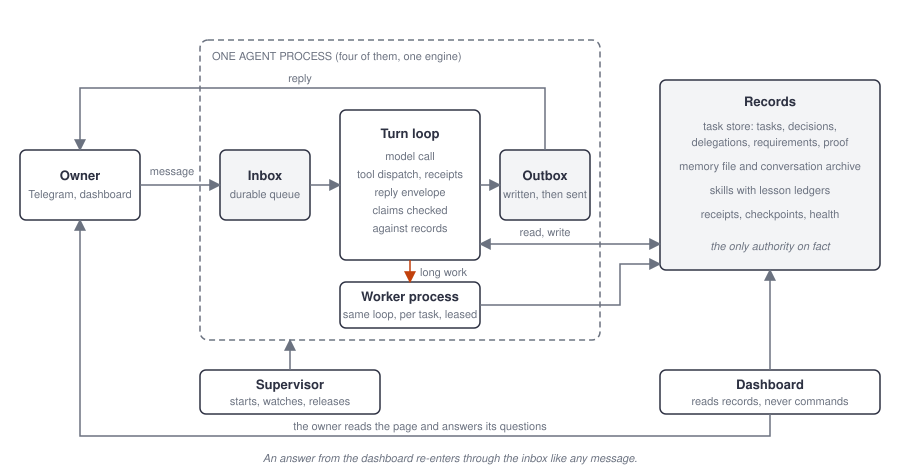

# Tabularium

**An owner-judged agent framework: the records decide, not anyone's word.**

[](https://github.com/Tonguso/tabularium/actions/workflows/tests.yml)
[](LICENSE)
[](pyproject.toml)
[](docs/WHITEPAPER.md)

Tabularium runs a small cast of AI agents for one person over Telegram. Each agent is a process with its own bot,
memory, skills and tools; a supervisor keeps them up; a local dashboard shows what they are doing and what they are
waiting for. The framework's one rule: no part of the system believes what another part says about its own work. A
claim of work started, a question asked, a file delivered or a check passed is a record the runtime wrote and can
read back, or it did not happen.

It is the code behind a working system: four agents, five weeks of daily use, 680 offline tests. The design and the
failures that produced it are in the white paper: [docs/WHITEPAPER.md](docs/WHITEPAPER.md).



**Contents:** [Quickstart](#quickstart) · [What you get](#what-you-get) · [Add the rest of the cast](#add-the-rest-of-the-cast) ·
[Configuration](#configuration) · [How it works](#how-it-works) · [Layout](#layout) · [Status](#status) ·
[Contributing](#contributing) · [Citation](#citation) · [Licence](#licence)

## Quickstart

One agent, talking to you on Telegram, in about ten minutes. Windows, Python 3.12 or newer.

```bat
git clone https://github.com/Tonguso/tabularium.git
cd tabularium
python -m venv .venv && .venv\Scripts\activate
pip install -r requirements.txt && pip install -e . --no-deps
copy config.example.bat config.bat
copy examples\minimal\SKILL.md cato\SKILL.md && copy examples\minimal\memory.md cato\memory.md
```

Then:

1. Create a bot with [@BotFather](https://t.me/BotFather) and get your own Telegram user id (message
   [@userinfobot](https://t.me/userinfobot)). Open `config.bat` and fill in `OWNER_TELEGRAM_USER_ID`,
   `TELEGRAM_BOT_TOKEN` and one model key, `ANTHROPIC_API_KEY` or `OPENAI_API_KEY`. The agent answers your user id
   and refuses everyone else.
2. Open `cato\SKILL.md` and write who the agent is and who you are. The example is a plain assistant; everything
   from the tone to what it must ask before doing is yours to change.
3. Start it:

```bat
call config.bat
python cato\telegram.py
```

4. Message your bot. In a second terminal, `call config.bat && python dashboard.py` and open
   <http://127.0.0.1:8220> to see the agent's turns, tasks and anything waiting on you.

`cato` is the coordinator slot of the roster: the agent that can learn from your corrections and, once the other
agents exist, delegate to them. On its own it is a complete single agent. The example files are in
[examples/minimal](examples/minimal/README.md).

## What you get

- **One turn, one record.** Every message becomes a turn whose reply is a declared envelope, and its claims
  ("I started the job", "I answered your three messages") are checked against the task and inbox records before
  anything is sent. A promise with no job behind it goes back to the model.
- **Durable everything.** Questions to you, confirmations of risky actions, outgoing messages, task state, tool
  receipts and requirements live in SQLite and files. A crash, a restart or an answer that arrives hours later loses
  nothing.
- **Background work with proof.** Long jobs run in worker processes with checkpoints, numbered requirements and
  declared checks that run on the delivered bytes. "Finished" is derived from the records, never declared.
- **Delegation by contract.** A coordinator briefs another agent with numbered obligations; delivery is accepted
  from the checks, not the report; what no check could confirm reaches you named as unproven.
- **Owner-judged learning.** Agents turn your corrections into exact skill edits and change nothing until you say so.
  Your verdict from the dashboard settles at once; an approved rule becomes one tagged entry in the skill's ledger,
  counted helped or hurt on later tasks.
- **Memory that is tested.** One readable memory file per agent, writes that must quote you, a weekly exam, and
  tidy-ups applied only after the exam passes on both versions.
- **Operations like software.** A supervisor, self-tests, weekly scorecards, per-task traces, a regression
  benchmark, and releases only onto tested, committed code.

## Add the rest of the cast

The roster is one table in `agent_core/roster.py`. The repository ships four entry points:

| Slot | Folder | Role | Needs |
|---|---|---|---|
| Coordinator | `cato/` | Talks to you, researches, delegates, learns | `TELEGRAM_BOT_TOKEN` |
| Librarian | `callimachus/` | Evidence gathering and knowledge records for the coordinator; two parallel workers | `CALLIMACHUS_TELEGRAM_BOT_TOKEN` |
| Engineer | `vitruvius/` | Builds and tests artifacts on the machine for the coordinator | `VITRUVIUS_TELEGRAM_BOT_TOKEN` |
| Private agent | `tacitus/` | Personal matters in confidence: no shell, no delegation, no learning loop | `TACITUS_TELEGRAM_BOT_TOKEN` |

Each needs its own bot token, a `SKILL.md` and an empty `memory.md`. With more than one agent, run them under the
supervisor instead of by hand: `start_supervisor.bat` starts every configured agent and the dashboard, restarts a
crashed one, and runs the test gate before a release (`python agent_control.py restart`).

## Configuration

Everything is an environment variable, set in `config.bat` (git-ignored) from `config.example.bat`. The minimal set
for one agent is three values; the rest are optional.

| Variable | Required | What it is |
|---|---|---|
| `OWNER_TELEGRAM_USER_ID` | yes | Your Telegram user id; the only user the agents answer |
| `TELEGRAM_BOT_TOKEN` | yes | The coordinator's bot token; one token per agent, never shared |
| `ANTHROPIC_API_KEY` / `OPENAI_API_KEY` | one of them | Model access. Both may be set; routing prefers the configured subscription route and falls back to the API |
| `CLAUDE_CODE_OAUTH_TOKEN` | no | Claude subscription route through the Claude Code CLI |
| `CALLIMACHUS_…`, `VITRUVIUS_…`, `TACITUS_TELEGRAM_BOT_TOKEN` | per agent | Tokens for the other slots |
| `TAVILY_API_KEY`, `ANYSEARCH_API_KEY` | no | Web search providers, tried in the order in `search_order.json` |
| `ELEVENLABS_API_KEY` | no | Spoken replies to voice notes |
| `EDGAR_IDENTITY` | no | Name and e-mail that SEC EDGAR requires of every client |
| `KNOWLEDGE_BASE_DIR` | no | The librarian's writable knowledge-base folder |

Subscription routes use the vendors' own clients and are the operator's responsibility under the vendors' terms.

## How it works

The white paper is the full account. The short version, with the figures from it:

- [One message, start to finish](docs/WHITEPAPER.md#33-one-message-start-to-finish): message, request built from
  the records, model and tools with receipts, a declared reply, claims checked, outbox.
- [Records](docs/WHITEPAPER.md#4-records): the task lifecycle table, decisions, requirements and proof, completion,
  receipts, the outbox.
- [Working together](docs/WHITEPAPER.md#5-working-together): delegation by contract, waiting without a slot,
  acceptance and the owner's view, privacy by role.
- [Learning](docs/WHITEPAPER.md#8-learning): a lesson recorded with its exact edit, the owner's verdict, trial,
  applied, checked on the next real task.
- [Safety rails](docs/WHITEPAPER.md#9-safety-rails): what each one stops and how.

The larger mechanisms each have a design note with the failure that motivated it and the measurement before and
after: [verification](docs/verification.md), [requirements](docs/requirements.md), [completion](docs/completion.md),
[context loading](docs/context-loading.md), [evaluation](docs/evaluation.md),
[provider routing](docs/provider-routing.txt).

## Layout

| Path | What it is |
|---|---|
| `engine.py`, `agent_core/` | The runtime: turn loop, reply envelope, tools, lifecycle, decisions, verification, memory, learning, outbox |
| `background_runtime.py` | Task store and background workers: queue, lanes, delegation register, acceptance, delivery |
| `supervisor.py`, `agent_control.py` | Process supervision, drain restarts, the test gate, status |
| `dashboard.py`, `dashboard/` | Local web page that reads the records; it never commands an agent |
| `<agent>/telegram.py` | One agent: its configuration, tools and persona on top of the shared `AgentApp` |
| `examples/minimal/` | A `SKILL.md` and `memory.md` to start the first agent from |
| `tests/`, `cato/tests/` | The offline test suites; a release runs both |
| `docs/` | The white paper, its figures, and the design notes |

## Status

Version 0.3. It runs daily, and it is not yet a drop-in product:

- Windows only. The batch files, the Task Scheduler supervisor, Outlook access and the desktop tool assume Windows;
  the engine, Telegram and SQLite do not. Cross-platform support is the next piece of work after packaging.
- The agents' prompts address the owner by a placeholder name. Making the owner's name a setting is open work.
- Subscription model routes (Claude Code, the ChatGPT desktop app) depend on those clients being installed and
  signed in; the paid APIs are the fallback.
- The four entry points are the working examples of the roster; their skills, memory and the owner's data are not
  included.

## Contributing

See [CONTRIBUTING.md](CONTRIBUTING.md): a failing test first, records over guesses, a concept budget, one release a
day. Security concerns: [SECURITY.md](SECURITY.md). Changes: [CHANGELOG.md](CHANGELOG.md).

## Citation

```bibtex
@misc{tabularium2026,
  title  = {Tabularium: An Owner-Judged Agent Framework},
  author = {Tong, Hogan},
  year   = {2026},
  url    = {https://github.com/Tonguso/tabularium}
}
```

## Licence

Apache License 2.0. See `LICENSE` and `NOTICE.md`.

## Disclaimer

Tabularium is a personal project extracted from one person's running system. It is not a product, carries no
warranty, and gives the agents real rights on the machine it runs on: a shell, the file system, email and a messaging
bot. Read [SECURITY.md](SECURITY.md) before running it.
