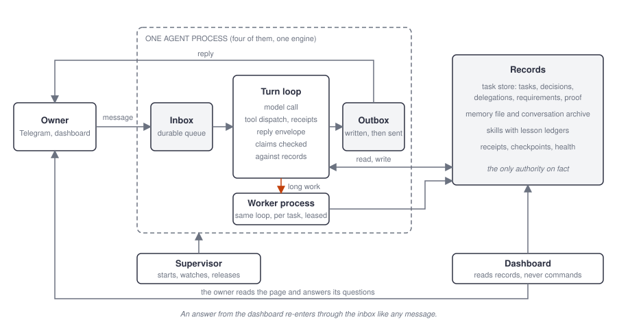
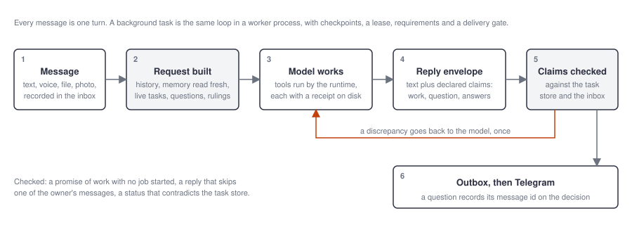
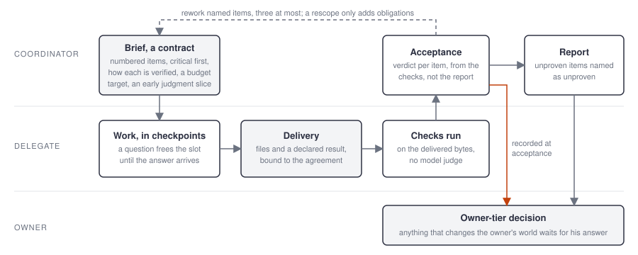
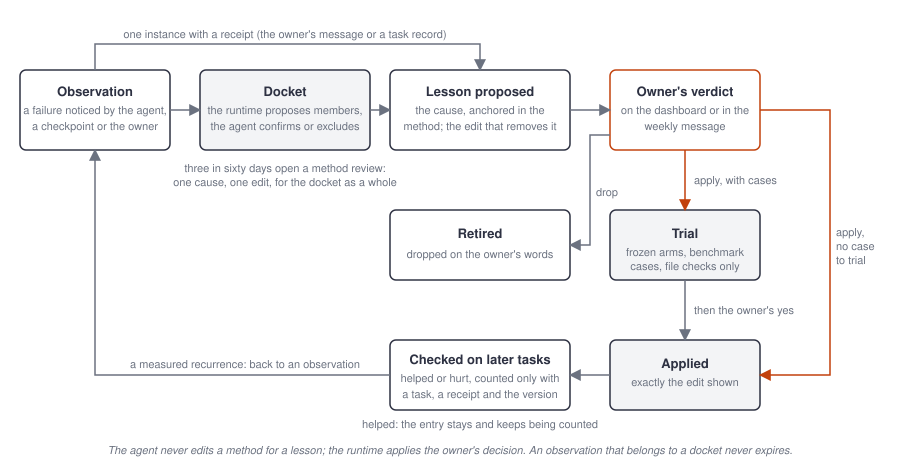

# Tabularium: An Owner-Judged Agent Framework

Version 0.5 (draft), 10 November 2026

## Abstract

Tabularium is a framework for running a small cast of AI agents on behalf of one person. It was built by that person
with two coding agents over four weeks of daily use, and it is published here as working code with nearly six hundred
tests. Its organising principle is simple to state and turns out to be hard to keep: no part of the system believes
what another part says about its own work. Where a conventional agent harness puts a rule in a prompt and trusts the
model to follow it, Tabularium writes a record and has the runtime check it: a task that was started, a question that
was asked, an answer that was given, a file that was delivered, a check that ran. The owner is the only judge of
quality; the records are the only authority on fact. This paper describes the design, the mechanisms that implement
it, the failures that produced each one, and what the approach cannot do.

## 1. Introduction

Most agent frameworks are built around the model: a loop that calls it, runs the tools it asks for, and returns its
last message. The framework's job is to make that loop convenient. The approach works for demonstrations and breaks
in daily use, for a reason that has nothing to do with model quality. A model produces text, and text can say
anything. "I have started the research" is one sentence whether or not a job exists. "Done" is one word whether or
not the file was written. A rule in the prompt ("never say done unless the file exists") is more text, and the model
follows it most of the time, which in daily use means it fails every few days.

Tabularium started as a chief-of-staff agent on Telegram for one owner and grew, failure by failure, into a framework
whose every mechanism answers the same question: what record, that code can read, says this actually happened? The
owner's complaints drove the design. An agent said work was running when it was not; the fix was a record of started
work that the runtime checks before a reply is sent. An agent asked the same question twice because the first answer
arrived while it was busy; the fix was a durable decision that a reply binds to. A build was accepted three times on
its builder's reports and crashed on first use; the fix was a declared check that runs on the delivered bytes and a
verdict that says how the reviewer knows.

The result is a system that is unusual in three ways. It is **owner-judged**: agents propose, trial and diagnose, but
nothing about how they work changes without the owner's own words. It is **record-first**: every claim, question,
confirmation, requirement and delivery is a row or a file before it is a sentence. And it is **operated like
software**: self-tests, a supervisor, release gating, scorecards, traces, incident reviews, and two independent coding
agents that change the code and check each other's work.

## 2. Design principles

Six rules explain almost every part of the system, and a proposed change is checked against them before it is made.

1. **The owner is the only judge.** Agents may notice a mistake, diagnose it and propose a fix, and the system tests
   the fix, but no rule changes without the owner's words.
2. **Records, not memory.** Anything that must survive a turn, a crash or a restart is written to a database or a
   file before it is acted on. The model's context is a view of the records, never the source of truth.
3. **Declared, not inferred.** Where the runtime needs to know something about a reply (what it answers, whether it
   started work, whether it was a correction), the reply declares it in a structured field and the runtime checks the
   declaration against the records. Nothing is inferred by reading prose.
4. **Nobody's word for their own work.** A worker's "done", a delegate's report, a model's grade of a model's answer:
   each is an assessment, stored as such, never a verdict. Verdicts come from checks the runtime ran.
5. **The code says no.** Rules the model could skip are enforced in code, and the refusal is visible: an undelivered
   reply is sent back, a blocked delivery says why, an unproven item is named to the owner as unproven.
6. **Fix the design, not the symptom.** A failure is a decision that allowed it. The fix removes the decision for
   every path that shares it, with a test that failed before. Patches, retries and special cases are refused.

## 3. Architecture

### 3.1 The cast

Four agents share one engine and have separate identities, skills, memory, folders and Telegram bots. They never share
a conversation and never read each other's files.

| Agent | Role | Delegates to | Notes |
|---|---|---|---|
| Coordinator | Research, analysis, coordination of the others | Librarian, engineer | Owns briefs, acceptance and the report to the owner |
| Librarian | Evidence gathering, knowledge records | Nobody | Two parallel workers; runs under the caller's budget |
| Engineer | Implementation on the owner's machine | Nobody | Single worker; builds and tests artifacts |
| Private agent | Personal matters, in confidence | Nobody | No shell, no delegation, no learning loop; records closed to maintainers |

The roster is one table in code. A role declares whether the agent delegates, how many workers it runs, whether the
owner's corrections start a diagnosis, and which tools it may hold. Adding an agent is adding a row.

Why several agents, when any agent can run workers? A worker is the same agent in another process: the same memory,
skills, tools and privileges, there so the agent keeps answering while long work runs. Separate agents give what a
worker cannot. First, privilege boundaries: no agent holds every tool, and the private agent's records are read by
nobody else, whereas a worker carries its parent's whole reach. Second, independent review: acceptance means
something only when the reviewer did not do the work, and a worker shares its parent's method and blind spots. Third,
a small, relevant context: each agent loads only its own memory and skills, where one agent in every role would carry
all of them on every turn. Fourth, isolation: a stuck agent does not take the others down, and each can run its own
model route. Fifth, separate conversations, so a confidential thread and a code review never share a history window.
The number four is not essential; the divisions that matter are privilege, independence of review and context size.

### 3.2 The machine

Six processes run on one PC: a supervisor, the four agents, and a dashboard. The supervisor starts the others,
adopts them after its own restart, watches heartbeats, and restarts a crashed process with a crash-loop guard; a
planned exit is acknowledged and never counted as a crash. Each agent is one Python process holding a Telegram
connection, an inbox, and the shared engine. Long work runs in a separate worker process per task, with a lease that
survives manager restarts. The dashboard is a local web page that reads the records; it never commands an agent.

| Part | What it is |
|---|---|
| Inbox | A small database per chat: waiting messages, follow-ups, updates to running jobs, usage events |
| Engine | Shared code: the turn loop, the tool dispatcher, the reply envelope, the safety rails |
| Task store | SQLite: tasks, their lifecycle, decisions, controls, delegations, requirements, proof, activations |
| Outbox | Every outgoing message, written before it is sent, retried in order after an outage |
| Memory | One text file per agent plus a searchable archive of every conversation |
| Skills | Folders with a written method (`SKILL.md`) the agent loads when a task matches |
| Checks | A daily self-test, a self-test after every model-client update, weekly memory exam and review |
| Desktop | The owner's screen, mouse and keyboard as one tool, taken per task on the owner's yes |

*Figure 1. One agent process and what surrounds it. The records are the only authority on fact; the dashboard reads them and never commands an agent; the owner's dashboard answers re-enter through the same inbox as a message.*

### 3.3 One message, start to finish

Every message becomes one turn: the model reads the message and the current records, uses tools, and returns one
reply. The path is the same for all four agents.

1. The owner sends text, a voice note, a document or a photo. Voice is transcribed; a voice message gets a spoken
   reply.
2. The inbox records the message durably, with its Telegram id. A message that arrives while a turn is running is
   queued, and the running turn is told about it at the next tool result, not after it finishes. A photo album
   reaches the inbox as one update per photo and is treated as one message: one turn, one reply, one queue notice.
3. The request is built from the saved history plus what is true now, attached to the latest message on the wire
   copy only: the core memory read fresh from the file, this turn's notes, live task status scoped to the request,
   pending questions, the owner's answers to this chat's questions over the last two days (rulings that bind every
   later question, from any turn or worker), and a runtime note if the owner has corrected the agent twice in the
   current thread.
4. The model works: tool calls are executed by the runtime, and each one leaves a receipt on disk before and after
   it runs. Tool outputs above a size are archived to files the model can read back, not kept in context.
5. The model returns a reply envelope: the reply text, what it claims (work started, question asked, request
   handled), which of the owner's messages it answers, and whether the owner just corrected it.
6. The runtime checks the claims against the records. A promise of work with no job started, a reply that leaves
   out one of the owner's messages, a status that contradicts the task store: the reply is sent back to the model
   with the discrepancy, once.
7. The reply goes to the outbox and on to Telegram, quoting the message it answers only when the owner has sent
   something else since. If it asked a question, the Telegram message id is recorded on the decision.

A background task is the same loop in a worker process, with checkpoints, a lease, requirements and a delivery gate.

*Figure 2. One message, start to finish. The reply's declared claims are checked against the records before anything is sent; a discrepancy goes back to the model once.*
Work that fits in the turn is done in the turn, with the agent's own tools; a worker is for research, long jobs and
work spanning many steps, because a worker starts without the turn's context and asks the owner again what the turn
already knew.

## 4. Records

The task store is the heart of the framework. Its tables, and what each one makes impossible, are the clearest
description of the design.

### 4.1 Lifecycle

A task's status changes only through named operations in one table: claim, run, park, wake, ask, answer, finish,
stop, recover, resume, reopen, cancel. Each names the states it may start from and the states it may lead to; a move
outside the table raises and writes nothing, and a move only succeeds if the task is still in the state the caller
read. A question about a finished task cannot silently reopen it; reopening is its own operation. Before this table
existed, task status was written by thirteen statements in two files.

### 4.2 Decisions

Everything an agent asks the owner is a decision: one durable row with the question, the task, the Telegram message
that asked it, and later the answer, its source message and the owner's quoted words. Two kinds exist. A question
("30 names or 50?") is answered by the owner's next message, or by a reply to the question's message, which binds
directly. A parked action (send this email, run this command) stores the exact inputs and runs only on a yes, whenever
it comes; a late yes is still a yes, and a restart forgets nothing. One pending question per task is enforced by a
unique index. Stale decisions are annotated when the task finished, was superseded, or the topic moved on.

### 4.3 Requirements and proof

A task carries its obligations with it. The brief and every later instruction become numbered requirements in the
database; a later checklist can add or revise, but omission never removes one. Each requirement can declare a check:
a command to run against the delivered file, or a literal the file must contain. The runtime runs the check on the
exact bytes (recorded by hash), stores the observed output as proof bound to those bytes and that requirement, and
derives the status: passed, failed, or unverified. A changed file, a changed test, a rework or an interrupted check
makes the proof stale. Model prose about a requirement is stored as an assessment, never as proof. A requirement
with no declared check (a comparison, a conclusion, a recommendation) is a judgment item: the owner judges it by
reading the result, and the runtime says nothing about it. Whether every instruction carries a declared requirement
is guidance shown to the worker, never evidence against finished work.

### 4.4 Completion

"Finished" is derived, not declared. A task finishes only when every declared check has current passing proof, no
question to the owner is pending, no instruction is undelivered, and every delegated piece has been accepted. A
worker's completed envelope with any of those missing ends in "needs attention" with a record of what is missing.
The earlier design ran three self-review retries on an unchanged draft and accepted "done" with a clear blocker; both
were deleted when this rule replaced them.

What completion could not confirm never changes the owner's message. The result reaches him as the worker wrote it;
the record of failed or unrun checks, unaccepted dependencies and unanswered decisions is a Checks segment on the
dashboard and a line on the task's card. Two earlier versions prefixed the message instead, and both produced the
same complaint: a complete report arriving under "not complete" because a requirement no machine could check, or the
runtime's own resume note, had been counted against it.

The same decision now also runs before the worker's final reply is accepted, while its tools are still available.
Failed or missing proof can then be repaired in a bounded number of attempts, valid proof is kept, and a genuine
wait or blocker is respected; only then is the reply final. This reuses the one completion decision and the
existing retry path rather than adding a second checker.

### 4.5 Receipts, checkpoints, activations, release

Every tool call writes a receipt before it runs and the outcome after, so a crash leaves the action's status known
rather than guessed, and a worker resuming from a crash inspects receipts before repeating an external action.
Workers checkpoint progress, facts, assumptions and decisions. An activation row records every start, resume and
reopen, and backs the reply envelope's "work started" claim. Each task records the commit of the code it ran on.

### 4.6 Outbox

Every message to the owner is written to a per-agent outbox before the send is attempted. A network failure or a
"not now" from Telegram leaves it queued; a retry thread delivers in order, dropping the connection pool before
retrying, and a chunk delivered more than two minutes late says when it was written. A stall shows on the dashboard
within a minute. A rejection by Telegram itself falls back to no quote, then plain text, and is marked failed only
after that.

## 5. Working together

### 5.1 Delegation by contract

Agents do not talk to each other. The coordinator writes a brief, because an AI writes a better prompt than a person,
and the brief is a contract: numbered completion items with the critical ones first, how each will be verified, an
early judgment slice the delegate finishes first, a budget target the delegate sizes its work by (never a stop), and
a completion condition. The request is recorded against the coordinator's task. The coordinator can read the
delegate's checkpoint, answer a question it stopped on, rework named items, or rescope by adding obligations; it
cannot silently remove one.

*Figure 3. Delegation by contract. The brief is the agreement; the delivery is bound to it; checks run on the delivered bytes; acceptance comes from the checks, and anything that changes the owner's world records a decision for him at acceptance.*

### 5.2 Waiting without a slot

When a coordinator's task is waiting on a delegate, it parks: the worker slot is freed, the runtime polls the delegate
without model calls, and the task wakes when the result returns or the delegate asks something. A hand-off made from
a conversation starts the delegate at once and creates the receiving task already parked, so the hand-off never queues
behind unrelated work.

### 5.3 Acceptance and the owner's view

Both agents work from one agreement: the delegate's requirements and every later clarification are one authoritative
record, the same record completion reads, with no separately maintained acceptance checklist. Delivery is blocked
until every attached result is read and accepted, and acceptance is bound to a specific returned delivery: a request
still in flight cannot be accepted, and rejection stays open until a rework returns. Acceptance is one verdict per
item, each saying how the reviewer knows: ran (executed, launched or opened it), read (inspected its content or
output), or report (the delegate's word). A ran or read claim with a declared check derives its status from the check;
the reviewer's judgment is recorded apart from that machine proof, and report-only items stay unverified and appear
in the dashboard's Checks segment as not run by the reviewer. A rework preserves the proof of items that did not
change. The delegate's own result is kept as fetched, and its DONE, OPEN, EVIDENCE and COST lines are appended
unedited beneath the coordinator's verdict, so the owner reads what the delegate claimed and what it left open. A
scorecard records, per request, what was asked, delivered, verified how, at what cost, with how many reworks.

Review has to converge. The Claude Code team's account of its own code review (October 2026) found that one change
went through more than fifty rounds of agent review and fixes, most of them re-flagging old code, and that a cap of
three rounds before the author rethinks raised once-through passes from 65% to 78%. Tabularium enforces the same cap
at the delegate tool: three reworks on one request, then the coordinator either accepts with the open items marked
not met, so the owner sees them, or writes a new brief. An item the current review accepted as met cannot be sent
back again. Each rework snapshots the artifacts behind the items sent back, and the next review records whether the
delegate changed them or waved the finding off; the weekly scorecard counts both, which is the post's measure of
reviewer noise, taken from the record instead of the reviewer's opinion. A verdict that rests only on the delegate's
word is refused until a cold reader, a stateless model call that sees the result and the numbered requirements and
nothing of the coordinator's conversation, has read that exact delivery. Finally, a request can be submitted as owner
tier, naming why the owner's yes is needed before the result is applied (it touches his machine, his index
calculation, his reference data, or sends on his behalf); acceptance then records a decision for him, because the
coordinator's accept is never the owner's approval. Everything else is applied on green checks without him.

The earlier acceptance kept three copies of the agreement (the requirements, the verdicts on the delegation row and
the scorecard) and never checked that the delegation had returned, so a report-only verdict could accept work still
in progress and a rejected requirement could vanish in a rework. Both were found by reading the code, not by an
incident, and replaced within the day.

### 5.4 Privacy by role

The private agent has no shell, cannot delegate, holds the smallest tool set, and its memory and conversations are
never read by the maintainers or the other agents; only its tool records may be inspected. The rule is enforced in
code and in the contribution rules, and the operations log notes compliance on every change that could touch it.

## 6. Talking to the owner

### 6.1 Asking

Questions and confirmations are decisions (section 4.2). The reply that asks carries the decision id, so the owner's
reply to that message answers it directly, with no search through history. The owner's answer arriving while the
agent is busy is recorded and delivered to the worker as a control at its next safe point. A question about a shape
goes out as the picture with the candidates drawn on it, red boxes and labels on a crop of the agent's own render,
with one plain question, not as a numbered list of geometry.

### 6.2 Waiting on an answer

A worker that asks the owner something ends its turn at the next settled action boundary: the current tool result is
saved, nothing further is started, the slot is freed, and the answer queues the continuation. Before this rule a
worker kept executing for minutes after asking, holding the slot while the next job waited.

Everything that waits on the owner is one page of the dashboard, "Waiting on you": every question from a background
task, every parked action and every proposed skill edit, oldest first, each opened and answered in place. A question
asked in the foreground is the conversation the owner is already in and does not appear. The answer travels through
the same durable inbox as any message, bound to the decision it answers. A verdict on a skill edit is settled by the
runtime the moment it arrives, as a parked action is; a question leaves the page once the agent records the answer. Before this page the questions existed only in the decision
store; nineteen of them had accumulated, visible only inside the dashboard's chat, and each answer meant finding the
question and typing a reply.

### 6.3 Corrections

Every reply names, by message id, which incoming messages corrected the agent. The ids come from the durable inbox
and the owner's own reply references, never from text copied back; a runtime warning carries no id and cannot be
counted (twice in October a warning injected by the runtime was recorded as the owner's correction and diagnosed as
his words). Corrections collect, and once the thread has been quiet for ten minutes one background diagnosis runs for the whole thread: what the agent did, what the owner expected,
why, and whose fault it was. A fault in the agent's method becomes a lesson: the decision in the method that allowed
it, anchored in the method file, the other observations it explains, and the edit that removes it; a one-off
misreading records nothing. A fault in the runtime becomes a report for the coding agents. The diagnosis never speaks to the owner and cannot ask him anything; he reads the digest when he
chooses. After two corrections in a thread, the agent's next reply may not fix, compute or propose anything: it
restates in the owner's words what it now understands and asks whether that is right.

The same diagnosis also receives two failures the runtime records itself, each marked as the runtime's record and
not the owner's words: a lesson that recurred on a real task, and a declared check that failed on a delivered file.
The diagnosis then drafts its lesson from the actual run rather than from a hand-written note about it.

### 6.4 Quoting and coverage

A reply quotes the message it answers only when the owner has sent something else since; every reply declares, by
message id, which of the owner's messages in the turn it answers, and a reply that leaves one out is sent back once.
Ids replaced copied text here too: an unrelated, unknown or invalid id cannot match by resemblance.

## 7. Memory

An agent's memory is one text file, readable by the owner, plus a searchable archive of every conversation. The
model remembers nothing between turns; the current file is attached fresh to the latest message of every request,
so a correction is in force from the next request and no stale copy can contradict it. One tool writes memory, and a
decision or preference of the owner can be written only with the message cited and the owner's words quoted, which
the runtime checks. Two checks run weekly. A memory exam takes a few durable things the owner said that week (not
instructions about one deliverable), has a separate model turn each into a question, asks the agent with only its
memory to go on, and records the score; it is shown on the dashboard with the missed questions. A memory review
proposes tidy-ups as a candidate copy, which is applied only after the exam passes on both the current and the
candidate version and the owner agrees, and only onto the version it was built from.

Core memory also keeps the standing matters of the owner's life (a purchase in progress, an open negotiation), each
with its current state and a few keywords. A message that names one of them arrives with that matter's newest
archived turns from before the conversation window, labelled as historical evidence. The window holds only the last
dozen or so exchanges; without this, a month of discussion about one standing matter of the owner's had rolled out of
sight, and the agent asked him who the buyer was.

## 8. Learning

Agents never quietly rewrite their own rules. Skills are folders of written method, separate from who does the work
and what it costs, so a method can be published without the practice. The loop that changes a method has one
principle: a failure is an observation, and a lesson is a claim about the decision in the method that allowed it.
The edit that closes a lesson removes that decision; a rule that must be remembered is a sign that the method still
permits the failure.

The first month of the loop had produced the opposite. The coordinator's register held 144 candidates in 23 themes
and 19 applied edits; every applied edit was a line appended to a skill's ledger and none rewrote a rule, while one
failure (briefs whose acceptance was stated in prose, so no script could verify the result) had recurred 116 times
and was still a candidate. The record was the unit of thought: one failure, one edit, appended because appending
needed no quotation and no judgement about what it replaced. The redesign of 2026-11-10 changed what the tool
accepts rather than what the agent is told.

1. **Observation.** A failure noticed by the agent, by a worker's checkpoint or by the owner's correction is recorded
   as an observation: text, time, source and task. Observations are evidence; they are never merged away, and an
   observation that belongs to a theme never expires.
2. **Cause.** To propose an edit, the agent names the cause: a claim about the decision in the method that allowed
   the failure, with an anchor the runtime checks, a passage quoted exactly from the method file, which the edit
   must then rewrite, or the statement that the method is silent at a named place, the only case in which a line may
   be appended. The agent also names the observations the cause explains. One instance is enough when it carries a
   receipt (the owner's message or a task record); a claim with neither a receipt nor a second instance stays an
   observation. The runtime checks the anchor and the observations; the claim itself is the owner's to judge
   against the instances it cites, as every edit is.
3. **Themes and method review.** The runtime proposes which observations belong together, from the same similarity
   measure the digest used, and stores the theme; only the owning agent confirms or reverses membership, so a wrong
   merge is undone without loss. Three observations within sixty days open a method review: one task in the runtime
   lane, keyed by the theme so it is never queued twice, that asks the agent for one cause and one edit for the theme
   as a whole. Later observations attach to the theme as unreviewed members instead of becoming new digest lines.
4. **The owner's verdict.** The runtime, not the agent, puts every proposal in front of the owner with its cause,
   its anchor and the observations it explains: on the "Waiting on you" page at any time, and in a weekly message.
   A verdict from the page is settled by the runtime on arrival. Drop retires the edit; apply starts the trial where
   the skill has benchmark cases. Where it has none, nothing is applied: the edit stays on the list with the reason
   and the owner chooses "apply it, no trial needed" or "draft a case first". Until this change an exception handler
   applied the edit when no trial could start, so a missing case was a reason to apply.
5. **Trial.** A screening, not an anecdote. The baseline skill and the exact candidate edit are frozen as two arms,
   development and reserved cases from the reviewed benchmark are run with both and repeated, files are graded by
   the independent artifact checks with no model judge, and actual usage is reported with unknowns left unknown.
   Trial workers hold read and write tools fenced to their own outputs, see no live memory or task context, and
   cannot send, delegate or record lessons. A case may declare fixtures the worker provides without a side effect:
   input files placed in the run's folder, a scripted delegate result, a scripted verification command with its
   exit code and output, scripted search results. So a method about delegating, verifying or reading inputs can be
   exercised, and live effects stay blocked.
6. **Applied.** On the owner's yes in his own words, the runtime applies exactly the proposed edit and bumps the
   skill's version, provided the passage the edit changes is still in the file. A rewrite replaces the anchored
   rule in place; an addition, allowed only where the method is silent, becomes one tagged entry in a ledger at the
   end of the skill, and the ledger never grows past five entries. Rewrites, removals and folds are always allowed,
   so a ledger of unproven entries never blocks the repair it needs. A fold takes entries with measured checks and
   a rewrite of the prose that absorbs them, shows before and after, and on approval applies both in one write
   guarded by the file's hash; the folded entries keep their keys as the provenance of the prose.
7. **Measured.** On the next real task where the failure could recur, the agent records whether it did. A check
   counts only when it is bound to a task, a receipt resolvable in the records (a result, a completion record or the
   owner's message) and the version of the method the task ran under; one task counts once per lesson. A check
   without those three is a judgement: kept and shown with the lesson, counting nothing. A measured recurrence
   before any success returns the lesson to candidate; a verified entry stays and keeps being counted.

*Figure 4. The life of a lesson. An observation becomes a lesson when the agent names its cause in the method; the
owner rules on the edit, the runtime applies or trials it, and measured checks on later tasks decide whether it
stays.*

Every lesson also carries its own benchmark case. When a lesson is recorded, the runtime drafts a case from it: the
request of the task it came from, or the owner's message when the lesson names it, as the input; the proposed edit's
text as the rule; and a placeholder for the expected answer, the checkable points and the fixtures, which the agent
fills in through the same lesson tool. Before a case can count, it is calibrated: three isolated runs per arm with
the skill as it stands, one arm given the request alone and the other the request with the rule stated outright. A
case that mostly fails even when told the rule is broken; a case the current skill mostly passes already proves
nothing; both are refused by code, and the rest wait for the owner's quoted yes before joining the benchmark, frozen.
Two or three approved cases of one skill recombine, by code, into a reserved case: one request carrying the others'
rules, held out so a trial can tell a learned rule from a memorised task. A trial with no chosen cases runs on the
skill's own development and reserved cases. The agent still writes the oracle, which is the risk; calibration catches
an internally broken case, and only the owner's spot-check catches a wrong reading of what he meant. This follows
GDPevo's construction of held-out tests from atomic rules, with the owner's gate in place of its reviewer agents.

The lesson guidance is one text kept with the package and appended to the prompt of every role that learns, so the
three learning agents cannot drift apart in how they treat a failure. The weekly digest lists the stored themes
with their counts and states and offers for retirement an entry that has hurt more often than it helped. Retirement,
like approval, happens only on the owner's quoted words; the counts come from measured checks, never from the
agent's opinion of its own rule. Proposals addressed to another agent's method, and lessons whose cause lies in
runtime code, are the next release: the design separates the right to propose from the right to write, and closes a
runtime lesson only with a release whose commit names it and a later measured check.

Each skill carries a track record (when it was last used, by which task, with what outcome) that the agent sees when
it loads one, so "I have used this before" is a fact.

## 9. Safety rails

Each rail exists because something went wrong once. The failure is the specification.

| Rail | The failure it stops | How it works |
|---|---|---|
| Declared work | "I will do X", then nothing happens | A promise with no activation record is sent back to the model |
| Declared answers | Several messages sent, one answered | A reply that leaves out a message is sent back once |
| Typed outcomes | A tool's "no" read as "done" | Refused and Failed are distinct types the code can see |
| Taint | Outside content instructing the agent to send mail or run a command | After reading outside content, sending and destructive commands become parked actions |
| Parked actions | A confirmation lost to a timeout or restart | The exact action is stored and runs only on the owner's yes |
| Desktop grant | An agent driving the owner's screen unasked, or into a password field | The desktop is taken per task on the owner's yes; the grant ends on his next message, after thirty minutes, or when he moves the mouse; a credential or payment window refuses input |
| Task lifecycle | Tasks silently changing state | Named operations checked against one table |
| Status from records | An agent claiming work is running when it is not | Live task status is attached to every turn; contradictions are logged |
| Requirement verification | A build accepted on its builder's report crashed on first use | Declared checks run on the delivered bytes; verdicts say how the reviewer knows |
| Delegate's own account | The coordinator as sole witness | The delegate's head lines travel unedited under the verdict |
| Durable requirements | An instruction lost when a checkpoint rewrote the list | Obligations have stable numbers; omission never removes one |
| One completion decision | A worker's "done" taken at its word | Finished is derived from proof, pending questions and accepted dependencies |
| Waiting on a decision | A worker holding its slot after asking | A pending question ends the turn and frees the slot |
| Correction bundling | Twelve diagnosis tasks from one argument | One silent diagnosis per quiet thread; the next reply restates |
| Durable outbox | A reply lost during an outage | Written to disk first, retried in order, stalls visible |
| Announced routes | Two days on a fallback model unannounced | A missing route is announced; a changed client runs the self-test |
| Truthful live status | A dead process shown idle; planned restarts counted as crashes | Status from process identity; unknowns shown as unknown |
| Lesson approval | Agents changing their own rules | Owner's words only; a trial first where the skill has benchmark cases, and where it has none the owner's explicit choice, never an exception handler's |
| Incoming files | A 20 MB screenshot reported twice as an internal error | One size gate for every incoming file; the owner is told the size and the limit |
| Owner tier | A coordinator's accept presented as the owner's approval | An owner-tier request records a decision for the owner at acceptance; nothing is applied until he answers |
| Memory candidates | A tidy-up that loses a fact | Exam before and after; applied only onto its base version |
| Checkpoints and receipts | A crash losing work | Every tool call is a receipt; progress is checkpointed |
| Drain restart | Restarting mid-task or onto broken code | Waits for work, runs all tests, refuses uncommitted code |
| Privacy by role | Maintainers reading private conversations | The private agent's records are closed; only tool records |

**Known gaps.** Command screening is a pattern list, not isolation; a real sandbox with desktop integrations behind
narrow host-side tools is the next large piece. A declared check proves that a test ran against those bytes, not that
the test was a good one.

## 10. Operations

Tabularium is run like software, which is uncommon for agent systems.

| Instrument | What it tells you | How often |
|---|---|---|
| Self-test | The agent can take a message, read a file and answer, and which model route answered | Daily, five minutes after every start, and whenever the model client changes |
| Scorecard | The week per agent: turns, bounced replies, corrections, tasks finished, delegated items met, memory exam | Weekly |
| Trace | Everything one task did, in order: tools, model calls, tokens, failures, minutes; usage is recorded per model call as it happens, so an interrupted session keeps its partial count | On demand |
| Regression benchmark | Fixed, reviewed synthetic cases with independent answers (six at the time of writing, with twenty-one objective checks and one declared subjective rubric); code checks the delivered files; pass rate and flaky cases per task type | Weekly, and after any change A change of the primary model or route reruns the benchmark once, in its own process, and the dashboard shows the new score beside the previous route's. |
| Interactive evaluation | The same benchmark machinery with events injected while a real, disposable agent process works: a scope update after the first write, a question followed by a process restart, a corrective follow-up beside a runtime warning, an incomplete delegate delivery; the state is checked independently after the process exits | On demand, after changes to the turn loop |
| Research signal | A few real past tasks rerun; a model says only whether each new answer is closer, the same, or further from the accepted one | Weekly; a signal, never a score |
| Live probes | Token use and pass rate before and after an engine change, on matched synthetic tasks | At each release |
| Incident reviews | What went wrong, what each actor could see, which design choice allowed it | After each failure the owner noticed |
| Release record | Which commit each task ran on | Every task |

Restarts drain current work, run the test suite, and refuse uncommitted code. The code has three authors, a human
owner and two coding agents, each recording every change in one operations log and never reverting another's change
until the owner confirms. The two coding agents work concurrently on purpose: each has caught real mistakes of the
other. A concept budget (a change that adds a named thing removes one) keeps the vocabulary in check. A rule of
one release a day held for two weeks and was dropped once the gate (tests, commit, announced graceful drain, live
verification) had proved sufficient on its own; six releases went out on one day without incident.

The code is one installable package; an installation is a home folder holding one folder per agent (named by its
role: coordinator, librarian, engineer, private), the settings, the logs and the dashboard's state. The release a
task ran on is the identity of the checkout that holds the package, never of the home, so a home that is only data
can start, and two installations on one machine never adopt each other's processes: every process names its home
on its command line. Agents learn in the home; the code changes only through the gate.

## 11. The owner's role

The system is built so that the human is the judge, not the operator. The jobs nobody else can do:

| Job | When |
|---|---|
| Apply or drop proposed skill edits, and rule on trial results | On the dashboard's "Waiting on you" page at any time, or from the weekly message |
| Answer questions and approve or decline parked actions | On the same page, or by replying on Telegram; there is no deadline |
| Approve memory tidy-ups, after seeing the exam before and after | After the weekly review |
| Read the lesson digest and the scorecard | Weekly |
| Say when something is wrong, in any words | Any time; the agent works out the specifics |
| Confirm which past answers were right, so the eval has trustworthy references | Occasionally |
| Authorise changes to the system in terms of what they will change for you | When a coding agent proposes one |

Everything else (diagnosing failures, writing fixes, testing them, restarting the agents, measuring) is done by the
agents and the coding agents.

## 12. Related work

Tabularium borrows from, and departs from, several lines of published work.

- **Reflexion and Voyager** keep verbal lessons and a library of executable skills. Tabularium keeps both, but gates
  promotion behind a trial and the owner's words; ungated libraries fill with the agent's own patches.
- **ACE (Agentic Context Engineering)** grows a playbook by delta edits with helpful and harmful counts per entry,
  curated by merging and retiring, instead of rewriting a prompt. Tabularium's lesson ledger follows that shape, with
  two differences: counts come from the runtime's recorded checks rather than the model's own grading, and every
  addition, merge and retirement waits for the owner's words.
- **Claude Code's code review** (Anthropic, October 2026) stacks checks by what could go wrong, caps review rounds at
  three, re-reviews only the new diff, never repeats a finding, measures reviewer noise by what the author did with
  each comment, and sets the risk tier by what a change touches, with an agent's approval never counting as a
  person's. Tabularium's delegate acceptance now carries the cap, the no-repeat rule, the per-finding outcome and the
  owner tier; the merge queue, feature flags and staged rollout are left out as a large team's concerns.
- **GEPA** evolves prompts by reflecting on execution traces and searching over variants under a metric. Tabularium
  takes the reflection and the separation of proposal from evaluation: a recurred lesson or a failed declared check
  feeds the diagnosis with the actual run, and a proposed edit is screened on frozen development and reserved cases.
  The variant search is not built, because there is no metric here that could rank variants without the owner.
- **Generative Agents** consolidate memory by periodic reflection. Tabularium's memory review does the same with an
  exam before and after and the owner's consent.
- **SWE-agent and Manus** argue that the agent-computer interface is the agent's intelligence: receipts, archived
  outputs, refusals of pointless repeats. Tabularium's receipts, archive and loop detectors follow that line.
- **τ-bench** showed that an agent passing a task once passes it only about half the time across repeats, and that
  this reliability is what users feel. Tabularium's benchmark reports pass-every-time and flaky cases per task type,
  and its interactive evaluation injects user events mid-task in the τ-bench manner, against real agent processes.
- **"Why do multi-agent LLM systems fail"** names specification, inter-agent misalignment and verification as the
  failure families. Tabularium's contracts, delegate's account and requirement verification address the second and
  third; the correction rules address the first.
- **Anthropic's building-effective-agents note** advises the simplest pattern that works. Tabularium's four agents
  are justified by trust boundaries (an agent for personal matters) and capability (an engineer with machine access), not by
  throughput.
- **Cognition's argument against multi-agent systems** holds that every hand-off loses context. Tabularium accepts
  the loss and makes it visible: the brief is a contract, the result travels unedited, and the coordinator is not
  the only witness.

## 13. Limitations

- The benchmark is small and synthetic; it proves the evaluator and the plumbing, not research quality. The research
  signal tracks drift but is not a score. A real task becomes a trustworthy case only with a declared check or an
  answer the owner confirmed.
- Declared checks prove execution against bytes, not that the check was the right one. Subjective quality remains a
  judgment, labelled as such.
- The system is single-owner, single-machine, Windows, and addresses the owner by name in prompts. Generalising
  these is open work.
- Model access through vendors' own clients is the operator's responsibility under the vendors' terms.
- Command screening is not a sandbox.

## 14. Lessons from building it

| Date | What went wrong | What changed in the design |
|---|---|---|
| 2026-10-12 | Working notes were delivered as a reply | The reply is a declared field; text outside it is never sent |
| 2026-10-16 | "I will narrow the research", and nothing started; two hours lost | Replies declare whether work started; an empty promise is sent back |
| 2026-10-20 | A second model checking replies appended stale task numbers to a correct answer | The checker was removed; status comes from records; nothing machine-written is added to chat |
| 2026-10-20 | The owner's answer arrived while the agent was busy and the question was asked again | Questions carry their message; a reply to it answers the decision |
| 2026-10-21 | Three messages in one turn; the reply answered one, quoted another, dropped the third | Replies declare which messages they answer; uncovered messages send the reply back |
| 2026-10-21 | Confirmations waited 60 seconds in memory; a late yes counted as no | Risky actions are parked as durable decisions with exact inputs |
| 2026-10-21 | A question about a finished task silently reopened it | One lifecycle table; reopening is a named operation |
| 2026-10-22 | A client update moved the preferred model; two days on the fallback unannounced | Missing route announced; a changed client runs the self-test; the self-test names its route |
| 2026-10-22 | Eleven corrections in an hour, each answered with a new fix; twelve diagnosis tasks asked for approval | One diagnosis per quiet thread, never a question; repeated corrections make the next reply a restatement |
| 2026-10-22 | A reply sat nine minutes while the messaging service refused it | Durable outbox; stalls visible |
| 2026-10-23 | A build accepted three times on reports crashed on the owner's first use | Verdicts say how the reviewer knows; checks run on the bytes; the builder's account travels with the verdict |
| 2026-10-23 | The evaluator graded prose against prose and passed a wrong file | Grading opens the deliverable; code decides objective items |
| 2026-10-24 | A worker that asked a question kept its slot; the next job timed out behind it | A pending question ends the turn and frees the slot |
| 2026-10-24 | A supervisor restart repeated every old failure notice | What the owner was told is kept on disk; routine results go to the dashboard |
| 2026-10-24 | Every research report arrived under "completion not verified" because a conclusion has no machine check | A requirement without a check is the owner's judgment; the runtime says nothing about it |
| 2026-10-24 | The runtime's own resume note was counted as an instruction nobody had covered, and blocked a complete report | Coverage is guidance to the worker; checks are a dashboard segment, never a prefix on the owner's message |
| 2026-10-24 | A warning the runtime injected was recorded as the owner's correction and diagnosed as his words | Corrections and answers name message ids from the inbox; warnings have none |
| 2026-10-25 | A lesson trial reran one task and let a model pick the winner | Frozen candidate, development and reserved cases, repeated runs, artifact checks only |
| 2026-10-25 | Acceptance never checked that the delegation had returned, and three copies of the agreement could disagree | One delivery-bound agreement, read by review and completion alike |
| 2026-10-26 | A 20 MB screenshot failed twice as "stopped with an error" | One size gate; a cause the owner can fix is said in one sentence |
| 2026-10-27 | Delegate reworks could loop without end (one engineering job cost about 1.8M tokens in rework rounds) | Three reworks are the cap; a met item cannot be re-flagged; each rework records whether the delegate changed anything |
| 2026-11-01 | A month of talk about one standing matter of the owner's had rolled out of the conversation window; the agent asked him who the buyer was | Standing matters live in core memory; a message naming one arrives with its newest archived turns |
| 2026-11-01 | 183 lessons recorded and 40 edits drafted; none had ever been shown to the owner | A lesson is recorded only with its edit; the runtime shows every proposal, on the dashboard and weekly |
| 2026-11-02 | Nineteen open questions sat in the decision store, visible only inside the dashboard's chat | One page lists everything waiting on the owner, answered in place |
| 2026-11-02 | One flaky run refused sound benchmark cases, and a model switch reran nothing | Calibration is a band over three runs per arm; a route change reruns the benchmark once |
| 2026-11-07 | Asked to operate the owner's machine, the agent could only answer that it had no tool that sees or touches the desktop | One desktop tool for every agent, granted per task by the owner's yes and released by his next message or his hand on the mouse |
| 2026-11-08 | One misaligned red strip on a logo produced fourteen questions to the owner in three hours, six of them re-offering what he had refused, from a foreground that briefed every nudge to a worker and from the worker itself | Work that fits in the turn is done in the turn; the owner's answers of the last two days ride in the live evidence of every turn and worker as rulings; a question about a shape goes out as the picture with the candidates drawn on it |
| 2026-11-08 | Twenty-five skill edits the owner had approved from the dashboard stayed on his list for a day: applying them depended on the agent running a trial no skill had cases for, then calling approve | The runtime settles a dashboard verdict in code the moment it arrives, as it settles a parked action: drop retires, apply runs the trial where the skill has cases and otherwise applies the edit and records why no trial ran; an edit on trial is the runtime's work, not the owner's, until its report returns |
| 2026-11-10 | A month of lessons had produced nineteen ledger reminders and no rewritten rule, while one failure recurred 116 times as unread candidates; the agent proposed patches because the record asked for one failure and one edit | A proposal names the decision in the method that allowed the failure, anchored in the method file, and the edit rewrites it; stored themes open a method review at three observations in sixty days; a check counts only with a task, a receipt and the method version; "apply it" without a usable case applies nothing |

Two patterns run through the list. Whenever the system guessed at something by reading text, it eventually guessed
wrong; each fix replaced the guess with a declared field or a record. And whenever it took an actor's word for its
own work, it eventually accepted a failure; each fix made the proof a record the runtime produces itself, and made
anything unproven say so to the owner. The name follows from the second pattern: the Tabularium was Rome's record
office, where the decisions and contracts that no magistrate's word could override were kept.

## Glossary

| Term | Meaning |
|---|---|
| Agent | One program with its own Telegram bot, folder, memory and skills |
| Owner | The one person the agents work for; the only judge |
| Turn | One message in, one reply out, with any tool calls between |
| Reply envelope | The structured reply: text plus declared claims the runtime checks |
| Task | A background job with a lifecycle, requirements, proof and a release record |
| Decision | A durable question or parked action, answered by the owner |
| Requirement | A numbered obligation of a task, optionally with a declared check |
| Proof | The recorded outcome of a check against exact bytes |
| Delegation | A contract from one agent to another, tracked to acceptance |
| Skill | A folder with a written method the agent loads when a task matches |
| Lesson | A claim about the decision in a method that allowed a failure, anchored in the method, with the observations it explains and the edit that removes it; trialled and applied or dropped by the owner |
| Observation | A recorded failure: text, time, source and task; the evidence a lesson is built from |
| Theme | A stored group of observations of one method, proposed by the runtime and confirmed by the owning agent; three in sixty days open a method review |
| Ledger | The section at the end of a skill where approved additions live as tagged entries with helped and hurt counts |
| Supervisor | The process that starts, watches and restarts the others |
